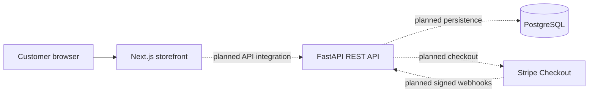

# System overview

## Context

Aureon Store is organized as a monorepo with separate web and API applications. This keeps the browser experience independent from commerce rules while preserving one development workflow.

## Current foundation

- The Next.js application owns the storefront interface and client-side navigation.
- The FastAPI application exposes versioned HTTP routes and typed configuration.
- Docker Compose provides local service discovery and a PostgreSQL service.
- GitHub Actions validates the web and API applications independently.

## Planned commerce boundaries

- The API will own catalog availability, prices, stock checks, cart validation, and order state.
- PostgreSQL will persist users, catalog items, variants, carts, orders, and payment events.
- Stripe Checkout will collect payment details; Aureon Store will not store card data.
- Verified, idempotent webhooks will be the source of truth for payment completion.

## Local ports

| Service | Port | Purpose |
| --- | ---: | --- |
| Frontend | 3000 | Storefront and future administration UI |
| Backend | 8000 | REST API and OpenAPI documentation |
| PostgreSQL | 5432 | Relational persistence |
